# Urodes — The Server Bone
> **BIF Viewer + PACS Viewer + Gateway** — 3 odalı patoloji/DICOM görüntüleme platformu. Backend normalizasyonu ve UI upgrade ile `the_server_bone`’dan evrilmiştir.

[](#)
[](#)
[](#)
[](#)

---

## 📸 Ekran Görüntüleri

### 1 — BIF Viewer Master (Dropzone & Inbox) — Gerçek Doku
Master rol: `src/bif-viewer/data/dropzone/`’a atılan BIF’leri içe aktarır. Arkaplan **B4075-25-HE.bif (72704×77824, 2.01 GB)** gerçek kesitinden alınmış overview (level 5).

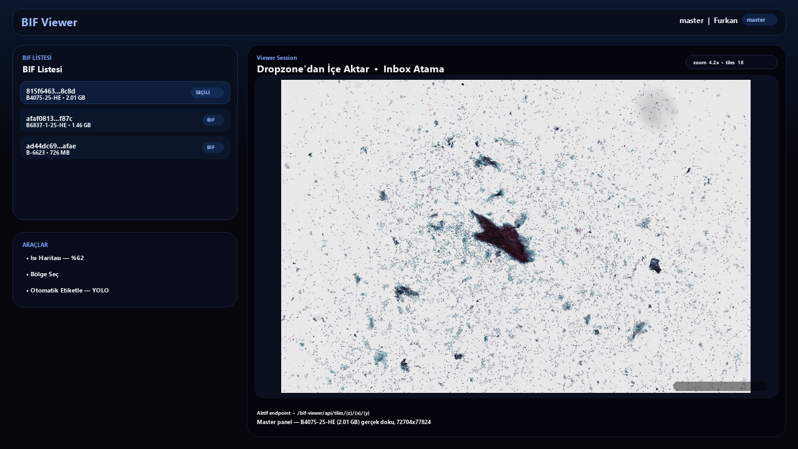
> Kaynak: `src/bif-viewer/data/slides/da796ca0-6aef-48c1-92aa-a738bcdb229b/2026/08/815f6463-2d1f-4bf5-b77a-63756e4d8c8d.bif` — `tifffile` ile level 5 (2272×2432) → `real-bif-1-overview.jpg`

### 2 — BIF Viewer (OpenSeadragon) — Gerçek Doku
Deep-zoom viewer sağda. Tile’lar `/bif-viewer/api/tiles/{z}/{x}/{y}` üzerinden akar. Görsel **B6837-1-25-HE** gerçek doku.

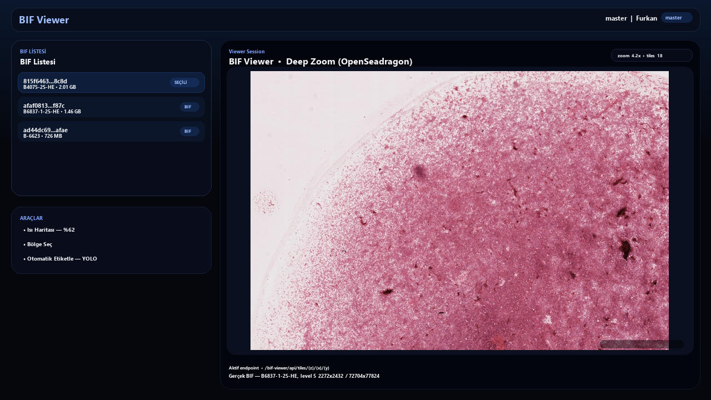
> Kaynak: `real-bif-2-overview.jpg` (level 5, 2272×2432)

### 3 — Isı Haritası (Heatmap) — Gerçek Doku Üzerinde
640×640 karolarla tam çözünürlük tarama, jet colormap. **Gerçek doku** üzerinde hücre yoğunluğu overlay (BIF-1 detail 2000×1500, level 2).

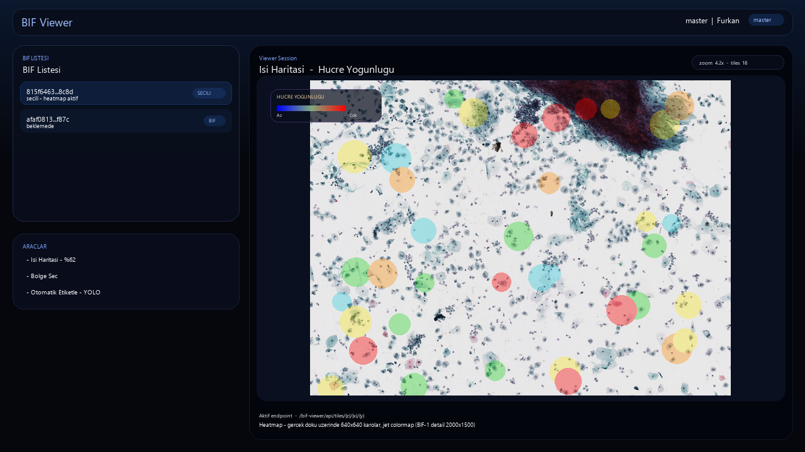
> Kaynak: `real-bif-1-detail.jpg` (13824×13312 level 2, crop 5000,5000 2000×1500) + sentetik heatmap overlay

### 4 — Otomatik Etiketle (YOLO) — Gerçek Doku Üzerinde
`src/bif-viewer/model/best.pt` ile tüm slayt taraması. **Gerçek kesit** üzerinde `urocell` bounding box’lar.

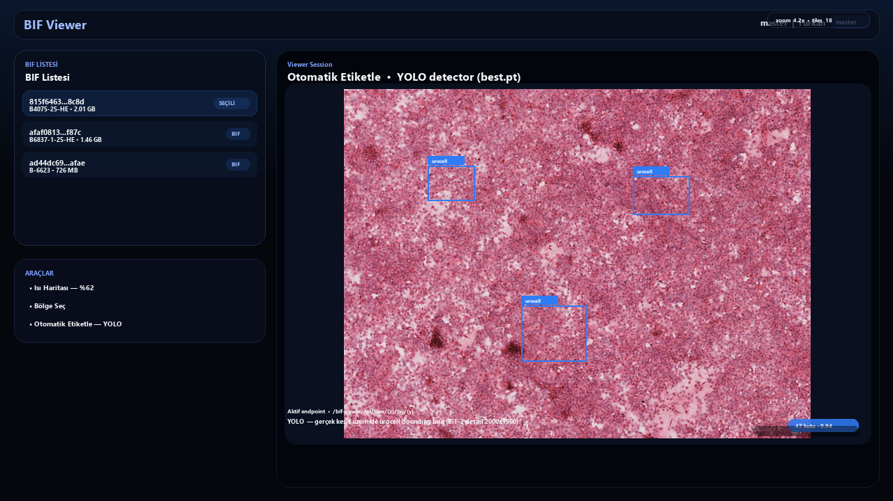
> Kaynak: `real-bif-2-detail.jpg` (18176×19456 level 2) + YOLO box overlay

### 5 — PACS Viewer — Gerçek Histoloji Arkaplan
`dcm4chee-arc 5.34.3` stack. Arkaplan gerçek histoloji overview ile.

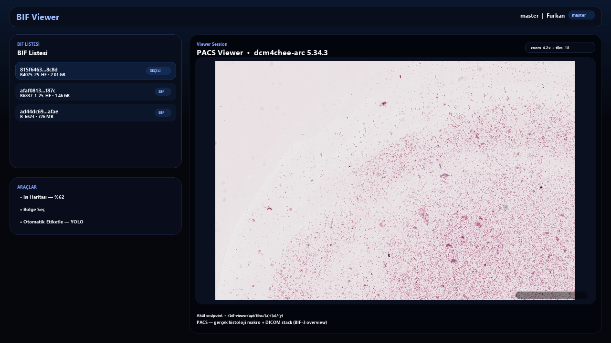
> Kaynak: `real-bif-3-overview.jpg` (2400×2304)

### 6 — Gateway & Mimari — Gerçek Doku Arkaplanlı
Nginx + oauth2-proxy + Keycloak. `rooms-enabled/` oda izolasyonu.

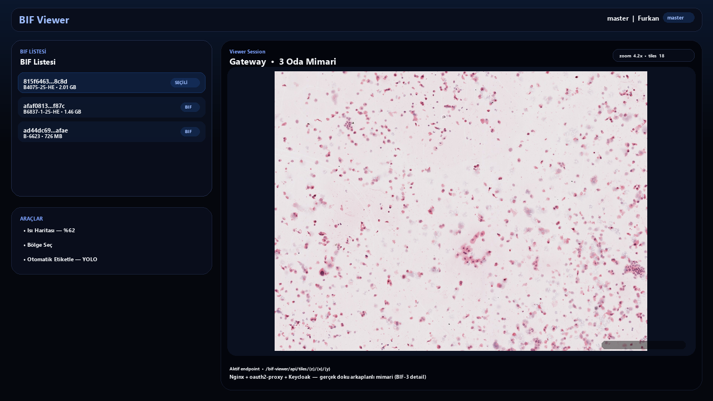
> Kaynak: `real-bif-3-detail.jpg` (19200×18432 detail)

### 7 — Gerçek BIF Kesitleri (Ham, İşlenmemiş)
`tifffile` + `imagecodecs` ile BIF içinden doğrudan çıkarılmış, **hiç sentetik olmayan** hücre kesitleri:

| BIF-1 Tile 640×640 (level 0, 55296×53248) | BIF-2 Tile 640×640 (level 0, 72704×77824) | BIF-3 Tile 640×640 (level 0, 76800×73728) |
|---|---|---|
| 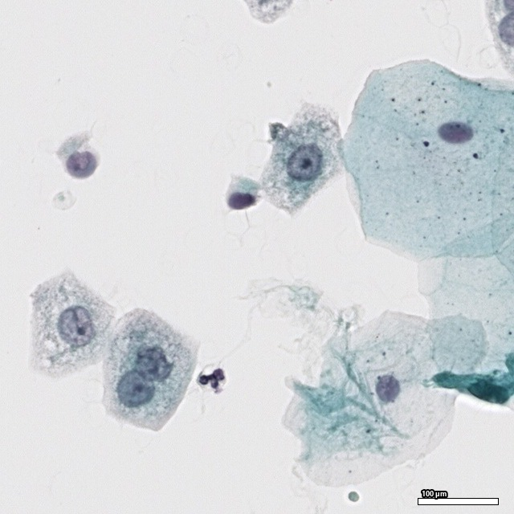 | 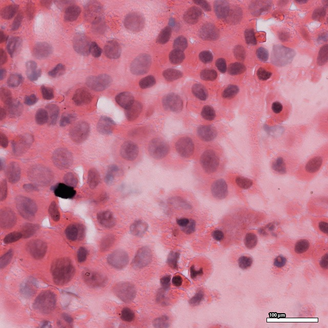 | 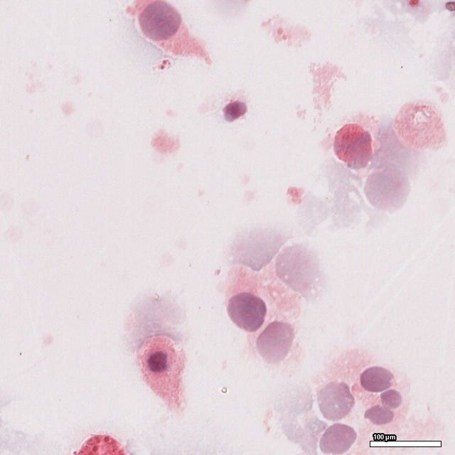 |
| `real-bif-1-tile640.jpg` 25000,25000 | `real-bif-2-tile640.jpg` 25000,25000 | `real-bif-3-tile640.jpg` 25000,25000 |

YOLO crop çıktıları (`src/bif-viewer/data/archive/ImageLog/`):

| Örnek 1 | Örnek 2 | Örnek 3 |
|---|---|---|
| 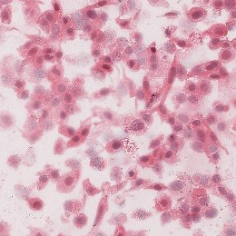 | 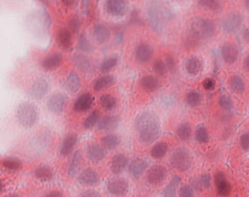 | 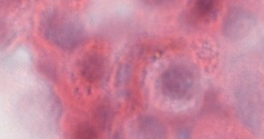 |

Makro görüntüler (BIF series 1, 3685×1251):

| BIF-1 Makro | BIF-2 Makro | BIF-3 Makro |
|---|---|---|
| 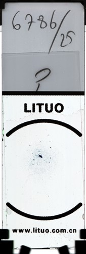 | 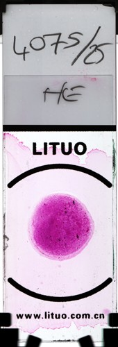 | 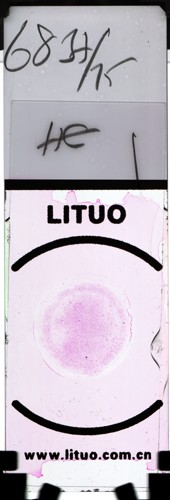 |

---

## 🏗️ Mimari

```
the_server_bone-main/
├── infra/certs/                 # TLS sertifikaları (gitignore)
├── scripts/                     # Orkestrasyon
│   ├── action_setup.sh          # chmod +x + ağ hazırlığı
│   ├── action_gateway_*.sh      # gateway up / check
│   ├── action_bif_*.sh          # bif up / check / dropzone
│   ├── action_pacs_*.sh         # pacs up / check / dicom store
│   ├── action_full_check.sh     # 5 adım full health check
│   └── file-source/             # print_utils, docker_network, gateway_env_check
├── src/
│   ├── gateway/                 # Nginx + oauth2-proxy + Keycloak
│   │   ├── docker-compose.yml
│   │   └── config/nginx/rooms-enabled/{bif-viewer,pacs-viewer}.conf
│   ├── bif-viewer/              # Patoloji BIF viewer
│   │   ├── app/backend/         # Java 17 / Spring Boot (Maven)
│   │   ├── app/frontend/        # Vite + OpenSeadragon
│   │   ├── model/               # best.pt (YOLO) + FastAPI
│   │   ├── data/
│   │   │   ├── dropzone/        # Master içe aktarım havuzu
│   │   │   ├── inbox/           # Offline ingest (/app/inbox)
│   │   │   ├── slides/          # İşlenmiş slaytlar (gitignore *.bif)
│   │   │   └── archive/         # ImageLog / JsonLog / TerminalLog
│   │   └── docker-compose.yml
│   └── pacs-viewer/             # DICOM PACS
│       ├── app/                 # React (PatientList, DicomViewer, ...)
│       ├── data/db/pgdata/      # Postgres (gitignore)
│       └── docker-compose.yml   # dcm4chee-arc-psql:5.34.3
├── docs/images/                 # README görselleri
└── Urodes-Model-v1/ & Urodes_Model_v2/  # Önceki model denemeleri (korundu)
```

**Oda (Room) kavramı:** Gateway `rooms-enabled/*.conf` ile odaları aç/kapa yapar. `action_bif_up.sh` ve `action_pacs_up.sh` ilgili conf’u `rooms-disabled/` → `rooms-enabled/` taşır.

---

## 🚀 Ayağa Kaldırma

### Ön Koşullar
- Docker & Docker Compose
- Git, bash (WSL/Git Bash)

### 1 — İlk Kurulum
```bash
./scripts/action_setup.sh
```

### 2 — Gateway
```bash
./scripts/action_gateway_up.sh
./scripts/action_gateway_check.sh
```

### 3 — BIF Viewer
```bash
# Model zaten entegre: src/bif-viewer/model/best.pt (19.8 MB)
./scripts/action_bif_up.sh
./scripts/action_bif_check.sh
./scripts/action_bif_dropzone_check.sh
```

BIF eklemek için (HTTP upload yok, offline ingest):
```bash
cp /path/to/file.bif src/bif-viewer/data/dropzone/
# veya
cp /path/to/file.bif src/bif-viewer/data/inbox/
# Master UI → Dropzone'dan İçe Aktar → Atama yap
```

### 4 — PACS Viewer
```bash
./scripts/action_pacs_up.sh
./scripts/action_pacs_check.sh
./scripts/action_pacs_dicom_store_check.sh
```

### 5 — Full Check
```bash
./scripts/action_full_check.sh
# [1/5] Gateway → [2/5] BIF → [3/5] Dropzone → [4/5] PACS → [5/5] DICOM store
```

### Ortam Dosyaları
```bash
cp src/gateway/.env.example src/gateway/.env      # doldur
cp src/pacs-viewer/.env.example src/pacs-viewer/.env
# infra/certs/internal-dev/  → TLS cert'leri (gitignore)
```

---

## 🔧 Backend Normalization

- **BIF Viewer Backend:** `src/bif-viewer/app/backend/src/main/java/bifviewer/`
  - `controller/` — Slide, Tile, Dropzone, Inbox, User, Archive, Metrics
  - `domain/` — `SlideStatus`, `IngestSource`, `SlideFormat`, `AppRole`
  - `infrastructure/ingest/` — `WatchedFolderIngestService`, `StabilityProbe`, `ProcessingMarker`
  - `infrastructure/storage/` — `FileSystemSlideStorage`
  - `openslide/` — `OpenSlideReaderService`, `OpenSlideTileService`, `OpenSlideExperimentService`
  - `service/` — `SlideApplicationService`, `BifReaderService`, `DropzoneService`, `TileService`
  - `resources/db/migration/` — `V1..V4` Flyway
- **Model:** `src/bif-viewer/model/app/main.py` (`MODEL_PATH=/model/best.pt` → `docker-compose.yml:63` mount)
- **Frontend:** `src/bif-viewer/app/frontend/src/viewer.js` — OpenSeadragon + prefetch + heatmap/autolabel state machine (640×640 tiled full-slide scan, localStorage resume)
- **PACS:** `dcm4che/dcm4chee-arc-psql:5.34.3`, `postgres-dcm4chee:11.22`, `slapd-dcm4chee:2.6.10`

---

## 🎨 UI Update & Upgrade

- **Tema:** `#0b1020 → #05070d` gradient, `rgba(9,14,28,0.92)` kartlar, `7da2ff` vurgu, `rounded 18–28px`, blur + glow
- **Master vs Viewer:** `viewer.js:69` `setupMasterUI()` ve `setupUI()` ayrımı, `hasRole("master")` ile yetkilendirme
- **Viewer:** `viewer.js:327` `resp-stage` — OpenSeadragon canvas + `crop-overlay` + `heatmap-legend` + `auto-label-toolbar` + `viewer-hud` (zoom/tiles/scale)
- **Araçlar:**
  - Isı Haritası — progress ring, jet colormap, yoğunluk legend
  - Bölge Seç — crosshair + `crop-canvas` + `crop-panel-slot`
  - Otomatik Etiketle — YOLO full-slide scan, `localStorage` ile sekme yenilenince kaldığı yerden devam
- **PACS UI:** `src/pacs-viewer/app/src/components/{PatientList, DicomViewer, MetadataPanel, ViewerPage}.js`

---

## 📦 Veri & Git

`.gitignore` bilerek büyük/runtime veriyi dışarıda bırakır:
```
*.bif, *.dcm, *.svs, *.ndpi, *.tiff
src/bif-viewer/data/slides/*, src/bif-viewer/data/**/*.bif
src/pacs-viewer/data/db/*, src/pacs-viewer/data/arc/*
node_modules/, dist/, *.zip
```

İlk publish filtresi: `scripts/action_git_first_publish.sh:181` — `.env`, `*.bif`, `*.dcm`, `pgdata`, `arc/data` git’e gitmez.

---

## 📝 Lisans & Notlar

- BIF’ler Ventana/Roche formatı, OpenSlide + özel `BifFormatHandler` ile okunur.
- `HALL_REFACTOR_PLAN.md` — refactor yol haritası.
- Model geçmişi korunmuştur: `Urodes-Model-v1/` (LFS) ve `Urodes_Model_v2/` klasörleri.

